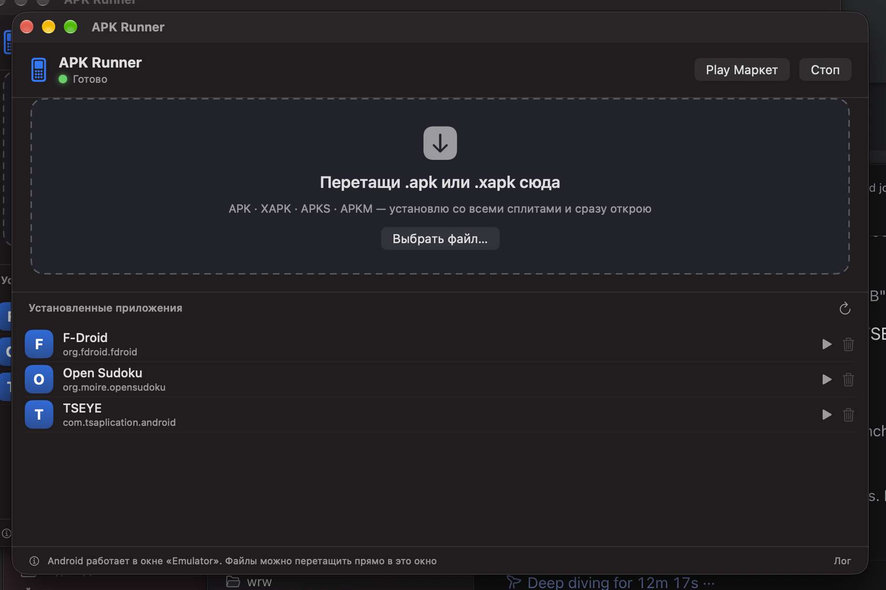
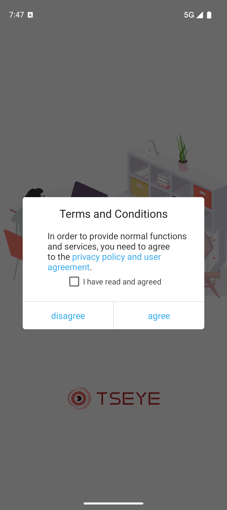
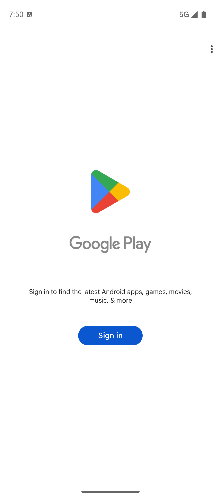

# APK Runner

Прослойка для macOS, которая запускает Android-приложения на Apple Silicon: **двойной клик по `.apk` или `.xapk` — приложение ставится в Android с Google Play и открывается**.

Своего эмулятора внутри нет: APK Runner — это удобная оболочка над официальным Android Emulator из Android SDK. Она сама поднимает виртуальное устройство, ставит пакет (включая сплиты и OBB-данные) и следит за тем, чтобы ошибки были понятны.



## Возможности

- **Установка двойным кликом.** Прослойка регистрируется как обработчик `.apk`, `.xapk`, `.apks` и `.apkm`.
- **XAPK как надо.** Распаковка, чтение `manifest.json`, установка `base.apk` + всех `config.*.apk` через `adb install-multiple`. Без этого Android отвечает `INSTALL_FAILED_MISSING_SPLIT`.
- **OBB-данные.** Файлы `Android/obb/<пакет>/*.obb` из бандла копируются в `/sdcard/Android/obb/<пакет>/` — иначе игры стартуют с чёрным экраном.
- **Настоящие названия.** Имя приложения берётся из APK через `aapt2 dump badging`, а не угадывается по имени пакета.
- **Автозапуск Android.** Если устройство выключено, двойной клик по файлу сам его поднимет (быстрый старт из снапшота — секунды).
- **Play Маркет и список приложений.** Запуск, удаление, обновление списка — из одного окна.
- **Понятные ошибки** вместо сырого вывода adb: не хватает сплитов, другая архитектура, не совпадает подпись, кончилось место.
- **CLI** — `apk-run файл.xapk` делает то же самое из терминала.

## Скриншоты

| APK ставится и запускается | Play Маркет |
|---|---|
|  |  |

## Требования

- macOS 14+ на Apple Silicon (проверено на M4 Max, macOS 27)
- Xcode Command Line Tools (`swiftc`) — для сборки
- ~13 ГБ на диске: Android SDK ~4 ГБ и данные виртуального устройства ~9 ГБ

## Установка

```bash
git clone https://github.com/smm959/apk-runner.git
cd apk-runner

# 1. Android SDK, образ с Google Play и виртуальное устройство
./scripts/setup-sdk.sh

# 2. Сборка и установка в /Applications
./scripts/build.sh --install

# 3. (необязательно) консольный хелпер
cp scripts/apk-run ~/.local/bin/apk-run
```

Если `cmdline-tools` ещё нет:

```bash
brew install --cask android-commandlinetools
```

## Использование

1. **Двойной клик по APK/XAPK в Finder** — Android поднимется, приложение установится и откроется.
2. **Перетащить файл в окно APK Runner** — то же самое.
3. **Play Маркет** кнопкой в окне — обычная установка, нужен вход в Google-аккаунт.

Android живёт в отдельном окне `Emulator` и не зависит от окна прослойки: её можно закрыть.

### Команды

```bash
apk-run file.xapk      # установить и запустить APK/XAPK/APKS/APKM
apk-run start          # включить Android
apk-run stop           # выключить Android
apk-run list           # установленные приложения
apk-run launch <pkg>   # открыть приложение по пакету
apk-run remove <pkg>   # удалить приложение
apk-run market         # открыть Play Маркет
apk-run shot out.png   # скриншот экрана Android
apk-run shell          # adb-шелл
```

## Как это работает

```
Finder ──двойной клик──▶ APK Runner.app ──▶ adb install / install-multiple
                              │                      │
                              │                      ▼
                              └──▶ emulator -avd ──▶ Android 16 (Google Play, arm64)
                                                     в виртуалке Apple Hypervisor
```

- Интерфейс — SwiftUI, ~900 строк, без внешних зависимостей.
- Весь Android-часть — стандартные `adb` и `emulator` из SDK; прослойка не патчит образ и не требует root.
- Выбор пакета и сплитов — по `manifest.json` (XAPK) либо по всем `*.apk` в архиве (APKS/APKM), base первым.
- OBB копируются до первого запуска приложения.

## Ограничения

- **Банковские приложения** (Сбер, Т-Банк, ВТБ, Госуслуги и подобные) и **игры с античитом** часто отказываются работать на эмуляторе: они проверяют признаки виртуалки. Это ограничение самих приложений.
- **Зашифрованные `.apkm`** (часть файлов APKMirror) не поддерживаются: внутри не APK, а шифрованный контейнер. Прослойка откажет с объяснением.
- Если в бандле **меньше сплитов**, чем у уже установленной версии, Android требует удалить приложение и поставить заново.
- Первый запуск macOS спросит разрешение «Локальные сети» — без него у Android не будет интернета.

## Структура

```
src/APKRunnerApp.swift   интерфейс и логика установки
src/Info.plist           бандл, обработчик .apk/.xapk
src/makeicon.swift       генератор иконки
scripts/build.sh         сборка .app из исходников
scripts/setup-sdk.sh     Android SDK, образ с Google Play, AVD
scripts/apk-run          консольный хелпер
```

---

## English

**APK Runner** runs Android apps on Apple Silicon Macs: double-click an `.apk` or `.xapk` and it is installed into an Android 16 device with Google Play, then opened.

It is a thin SwiftUI shell over the official Android Emulator — no custom VM, no root, no patched images.

- Handles `.apk`, `.xapk`, `.apks`, `.apkm`: reads `manifest.json`, installs `base.apk` plus all `config.*.apk` splits via `adb install-multiple`, and copies OBB payloads to `/sdcard/Android/obb/<package>/`.
- App names come from `aapt2 dump badging`.
- Boots the emulator on demand and reports human-readable install errors.
- CLI: `apk-run file.xapk`, `apk-run start|stop|list|launch|remove|market|shot|shell`.

Requirements: macOS 14+, Apple Silicon, Xcode CLI tools, ~13 GB disk.

```bash
git clone https://github.com/smm959/apk-runner.git && cd apk-runner
./scripts/setup-sdk.sh
./scripts/build.sh --install
```

Known limits: banking apps and anti-cheat games usually refuse to run on emulators; encrypted `.apkm` files are not supported.

## License

MIT — см. [LICENSE](LICENSE).
