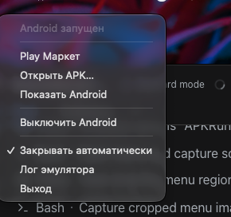
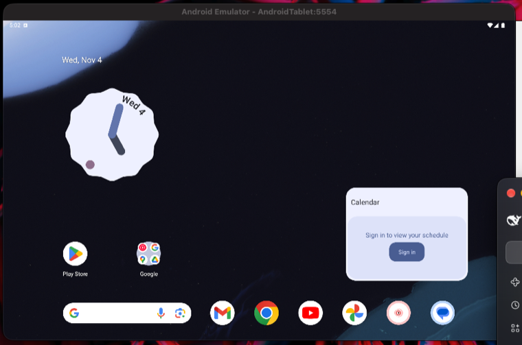

# APK Runner

Запуск Android-приложений на Apple Silicon Mac: **двойной клик по `.apk` или `.xapk` — приложение открывается в окне планшета**.

Помощник не висит в Dock и не держит окон: он живёт в строке меню, запускается в момент открытия файла и закрывается сам через три минуты бездействия. Внутри — официальный Android Emulator (Android 16, Google Play, arm64).

| Меню в строке меню | Окно планшета |
|---|---|
|  |  |

## Возможности

- **Только строка меню.** Ни Dock-иконки, ни окон-панелей: приложение — фоновый помощник (`LSUIElement`).
- **Сам становится обработчиком.** `build.sh --install` и запуск приложения назначают его открывать `.apk`/`.xapk` — иначе их перехватывает архиватор вроде Keka.
- **Запуск по требованию.** Клик по APK в Finder запускает помощник, тот поднимает Android (если выключен), ставит пакет и открывает приложение.
- **Сам закрывается.** Через 3 минуты бездействия помощник выходит; Android продолжает работать. Автозакрытие отключается галочкой в меню.
- **Планшетное окно.** AVD `Pixel Tablet`: 2560×1600, Android 16 с Google Play — приложения открываются в планшетной раскладке.
- **XAPK как надо.** `base.apk` + все `config.*.apk` через `adb install-multiple`, OBB-данные копируются в `/sdcard/Android/obb/<пакет>/`.
- **Настоящие названия приложений** из APK (`aapt2 dump badging`), а не из имени пакета.
- **Понятные ошибки** вместо сырого вывода adb: не хватает сплитов, другая архитектура, не совпадает подпись, кончилось место.
- **CLI** — `apk-run файл.xapk` делает то же самое из терминала.

## Требования

- macOS 14+ на Apple Silicon (проверено на M4 Max, macOS 27)
- Xcode Command Line Tools (`swiftc`) — для сборки
- ~13 ГБ на диске: Android SDK ~4 ГБ и данные виртуального устройства ~9 ГБ

## Установка

```bash
git clone https://github.com/smm959/apk-runner.git
cd apk-runner

# 1. Android SDK, образ с Google Play и планшетное виртуальное устройство
./scripts/setup-sdk.sh

# 2. Сборка и установка в /Applications
./scripts/build.sh --install

# 3. (необязательно) консольный хелпер
cp scripts/apk-run ~/.local/bin/apk-run
```

Если `cmdline-tools` ещё нет:

```bash
brew install --cask android-commandlinetools
```

## Использование

- **Двойной клик по APK/XAPK в Finder** — Android поднимется, приложение установится и откроется в окне планшета.
- **Меню в строке меню** (иконка планшета):

| Пункт | Что делает |
|---|---|
| `Play Маркет` | открыть магазин на устройстве |
| `Открыть APK…` | выбрать файл вручную |
| `Показать Android` | вывести окно планшета вперёд |
| `Выключить Android` / `Запустить Android` | управление виртуальным устройством |
| `Закрывать автоматически` | автовыход через 3 минуты бездействия |
| `Лог эмулятора` | `/tmp/apkrunner-emulator.log` |

### Команды

```bash
apk-run file.xapk      # установить и запустить APK/XAPK/APKS/APKM
apk-run start          # включить Android
apk-run stop           # выключить Android
apk-run list           # установленные приложения
apk-run launch <pkg>   # открыть приложение по пакету
apk-run remove <pkg>   # удалить приложение
apk-run market         # открыть Play Маркет
apk-run shot out.png   # скриншот экрана Android
apk-run shell          # adb-шелл
```

## Как это работает

```
Finder ──двойной клик──▶ APK Runner (агент в строке меню)
                              │  adb install / install-multiple
                              ▼
                         emulator -avd AndroidTablet (Pixel Tablet 2560×1600)
                              │
                              ▼
                         окно планшета с запущенным приложением
```

- Интерфейс — SwiftUI (`MenuBarExtra`), без внешних зависимостей.
- Android-часть — стандартные `adb` и `emulator` из SDK; образ не патчится, root не нужен.
- Сплиты выбираются по `manifest.json` (XAPK) либо по всем `*.apk` в архиве (APKS/APKM), base первым.
- OBB копируются до первого запуска приложения.

## Ограничения

- **Банковские приложения** (Сбер, Т-Банк, ВТБ, Госуслуги и подобные) и **игры с античитом** часто отказываются работать на эмуляторе — они проверяют признаки виртуалки.
- **Зашифрованные `.apkm`** (часть файлов APKMirror) не поддерживаются: внутри не APK, а шифрованный контейнер.
- Если в бандле **меньше сплитов**, чем у установленной версии, Android требует удалить приложение и поставить заново.
- **Окно принадлежит эмулятору.** У него есть системный заголовок и боковая панель; панель закрывается крестиком, но при следующем запуске появляется снова. Убрать её совсем можно только заменив окно эмулятора на собственную трансляцию экрана (scrcpy), это отдельная задача.
- Первый запуск macOS спросит разрешение «Локальные сети» — без него у Android не будет интернета.

## Структура

```
src/APKRunnerApp.swift   агент в строке меню и логика установки
src/Info.plist           бандл, LSUIElement, обработчик .apk/.xapk
src/makeicon.swift       генератор иконки
scripts/build.sh         сборка .app из исходников
scripts/setup-sdk.sh     Android SDK, образ с Google Play, планшетный AVD
scripts/apk-run          консольный хелпер
```

---

## English

**APK Runner** runs Android apps on Apple Silicon Macs. Double-click an `.apk` or `.xapk` and it opens in a tablet window.

The helper has no Dock icon and no panels: it lives in the menu bar, starts when you open a file, and quits itself after three idle minutes. Under the hood it drives the official Android Emulator (Android 16, Google Play, arm64) on a Pixel Tablet AVD (2560×1600).

- Handles `.apk`, `.xapk`, `.apks`, `.apkm`: reads `manifest.json`, installs `base.apk` plus all `config.*.apk` splits via `adb install-multiple`, copies OBB payloads to `/sdcard/Android/obb/<package>/`.
- App names come from `aapt2 dump badging`; install errors are human-readable.
- CLI: `apk-run file.xapk`, `apk-run start|stop|list|launch|remove|market|shot|shell`.

Requirements: macOS 14+, Apple Silicon, Xcode CLI tools, ~13 GB disk.

```bash
git clone https://github.com/smm959/apk-runner.git && cd apk-runner
./scripts/setup-sdk.sh
./scripts/build.sh --install
```

Known limits: banking apps and anti-cheat games usually refuse to run on emulators; encrypted `.apkm` files are not supported; the emulator window keeps its own title bar and a side panel.

## License

MIT — см. [LICENSE](LICENSE).
